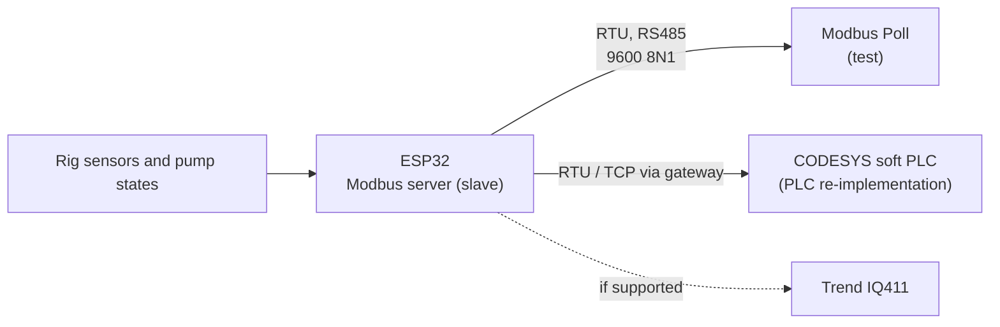

# ESP32 as a Modbus Server: Serving Plant Points to Real Controllers (Design Stage)

**Closing the loop between field devices and real BMS/PLC controllers: an ESPHome board acts as a Modbus server (slave), publishing plant points in a documented register map so the rig's Trend IQ411, a CODESYS soft-PLC or any Modbus client can read them, the reverse of the earlier Modbus projects where the ESP was the client.**

> **The short version:**
> - **Role reversal:** in the water-metering project the ESP polls a meter (client/master); here it **is** the device (server/slave).
> - **Transport:** Modbus RTU over RS485 using ESPHome's Modbus server capability ⟨confirm the component and its options in the current ESPHome⟩; Modbus TCP via an RTU-to-TCP gateway or a custom component ⟨choose⟩.
> - **Register map:** holding/input registers with scaling (e.g. temp × 10 as INT16), documented like a manufacturer's map.
> - **Clients:** CODESYS (PLC re-implementation, #13), the Trend IQ411 (if it has a Modbus option ⟨verify⟩), Modbus Poll for testing.

**Portfolio position:** Field level · protocol. Builds on: [Modbus RTU metering](https://github.com/the-control-cabinet/mains-water-metering-modbus-rtu) · [Modbus TCP lab](https://github.com/the-control-cabinet/modbus-tcp-data-collector). Feeds: [Trend IQ411](https://github.com/the-control-cabinet/trend-iq411-commissioning) · PLC re-implementation (#13)

---

## Status at a glance

| Item | Status |
|---|---|
| Register map v1 (input + holding registers, scaling, status bitfield) | 📐 Drafted ([doc 01](docs/01-register-map.md)) |
| Test plan (FC03/FC04, exceptions, bus loss, PLC client) | 📐 Drafted ([doc 02](docs/02-tests.md)) |
| RS485 hardware (FTDI adaptor) and Modbus RTU experience | ✅ From the [water metering](https://github.com/the-control-cabinet/mains-water-metering-modbus-rtu) project |
| ESPHome server component confirmed, first reads from Modbus Poll, CODESYS client | ⏳ To do |

## Why build the server side

Most BMS integration work is reading other people's Modbus devices: getting the register map, the scaling and the word order right. Building the device side once makes those maps make sense: you choose the register types, decide what a status bitfield holds, and see what an exception response looks like from the inside. This ESP32 publishes the rig's plant points so that a PLC (and possibly the Trend controller) can read them like any third-party device.

## Architecture

## Register map (v1)

| Register | Type | Point | Scaling | Units | Access |
|---|---|---|---|---|---|
| 30001 | Input, INT16 | Process temperature | × 10 | °C | R |
| 30002 | Input, INT16 | Pump 1 run hours | × 1 | h | R |
| 30003 | Input, UINT16 | Status bits: pump 1 run, pump 2 run, fault, lockout | bitfield | | R |
| 40001 | Holding, INT16 | Setpoint | × 10 | °C | R (write in phase 2) |

**Comms:** RTU, 9600 baud, 8N1; function codes 03 and 04 in phase 1, 06/16 in phase 2; byte and word order documented in the CSV, as a manufacturer's map would.

## Tests

| Test | Pass when |
|---|---|
| Read input registers (FC04) | Values match the ESP's sensors with correct scaling |
| Read holding register (FC03) | Setpoint readable |
| Illegal address | Exception response returned |
| Bus loss | Client times out cleanly; the ESP keeps running |
| CODESYS client | Points read into the PLC program |

## Design decisions

- **Read-only first:** a writable setpoint only arrives in phase 2, with limits, so a misbehaving client can't drive the plant.
- **Integer registers with documented scaling** (× 10) rather than floats, the most portable choice across BMS and PLC clients.
- **A status bitfield** for discrete states: one register, one read, the way packaged plant usually reports.

## Documents

| Doc | Contents |
|---|---|
| [01 Register map](docs/01-register-map.md) | Documented like a device manual |
| [02 Tests](docs/02-tests.md) | Client reads, scaling, error handling |

## Roadmap
- [ ] Confirm the ESPHome Modbus server options (RTU)
- [ ] Register map v1 (read-only)
- [ ] Test with Modbus Poll over the FTDI RS485 adaptor
- [ ] CODESYS client; then the Trend IQ411 if supported
- [ ] Phase 2: writable setpoint with limits

## Skills demonstrated (as built)
| Skill | Evidence |
|---|---|
| Modbus server design | Register map with scaling and status bits |
| Protocol depth | Function codes, exceptions, byte order |
| Integration | Field device → PLC/DDC controller |

📺 [The Control Cabinet on YouTube](https://www.youtube.com/channel/UC5Cupmz7vlfcodpCX7k8iuQ)

*Built and documented by James · part of [The Control Cabinet BMS portfolio](https://github.com/the-control-cabinet/the-control-cabinet). MIT Licence.*
